

  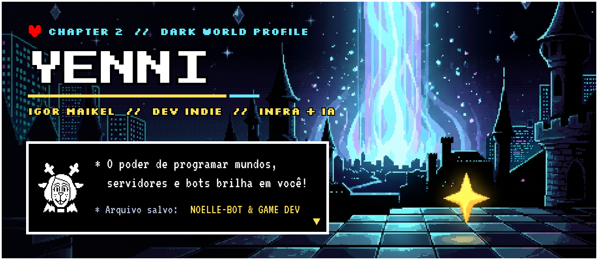

 

  <table>
    <tr>
      <td align="center" width="170">
        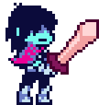 
        <b>KRIS</b> • <code>Lógica & Código</code>
      </td>
      <td align="center" width="170">
        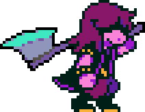 
        <b>SUSIE</b> • <code>Game Dev Indie</code>
      </td>
      <td align="center" width="170">
        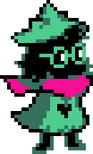 
        <b>RALSEI</b> • <code>Infra & Servidores</code>
      </td>
      <td align="center" width="170">
        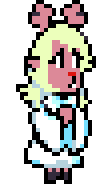 
        <b>NOELLE</b> • <code>Noelle-bot & IA</code>
      </td>
    </tr>
  </table>

  <a href="#sobre-mim">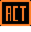</a>&nbsp;&nbsp;
  &nbsp;&nbsp;
  &nbsp;&nbsp;
  

---

  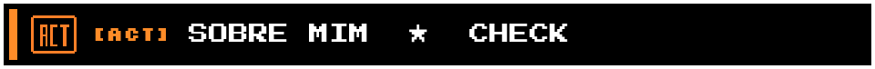

> **`* Você usa CHECK em Igor Maikel (Yenni) — LV 20 · ATK 15 · DEF 20`**  
> *"* Estudante de Ciência da Computação transformando lógica, infraestrutura e histórias em mundos interativos."*

<table>
  <tr>
    <td width="120" align="center">
      
    </td>
    <td>
      <ul>
        <li>🎓 Graduando em <b>Ciência da Computação (BCC)</b>.</li>
        <li>⚙️ Experiência prática com <b>infraestrutura, Linux e servidores</b> — configuração, gerenciamento de instâncias e deploy focado em <b>IA</b>.</li>
        <li>🎮 Como <b>Desenvolvedor Indie</b>, combino programação sólida, <i>world-building</i> e narrativas interativas.</li>
        <li>✍️ Nas horas vagas, exploro escrita criativa, design de mundos, mods e utilitários experimentais.</li>
      </ul>
    </td>
  </tr>
</table>

---

  

  <table>
    <tr>
      <th align="left">⚔️ Slot</th>
      <th align="left">Equipamentos</th>
      <th align="left">Especialidade</th>
    </tr>
    <tr>
      <td><b>ARMAS</b></td>
      <td><code>C</code> · <code>C++</code> · <code>C#</code> · <code>Python</code> · <code>Lua</code> · <code>Java</code> · <code>Bash</code></td>
      <td>Sistemas, automação, bots e gameplay</td>
    </tr>
    <tr>
      <td><b>MAGIA</b></td>
      <td><code>Godot</code> · <code>Unity</code> · <code>GDScript</code></td>
      <td>Jogos indie, prototipação e world-building</td>
    </tr>
    <tr>
      <td><b>ARMADURA</b></td>
      <td><code>Linux</code> · <code>Ubuntu</code> · <code>Git</code> · <code>Servidores / IA</code></td>
      <td>Infraestrutura, hospedagem e deploy de instâncias</td>
    </tr>
  </table>

 

  

---

  

  <table>
    <tr>
      <td align="center" width="110">
        
      </td>
      <td>
        <b>☀️ <a href="https://github.com/Yenni-Mid/O-Dia-que-o-Sol-sorriu">O-Dia-que-o-Sol-sorriu</a></b> <i>(Público · Godot Engine 4)</i> 
        Jogo de terror psicológico 3D em primeira pessoa com estética PS1, shaders CRT/VHS, mapa diegético em 3D e mecânicas furtivas de luz e sanidade.
      </td>
    </tr>
    <tr>
      <td align="center" width="110">
        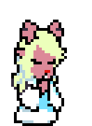
      </td>
      <td>
        <b>❄️ Noelle-bot</b> <i>(Privado · em desenvolvimento ativo)</i> 
        <i>Anteriormente Sunny-BOT</i> — Assistente autônomo modular com IA, voz, RPG engine, PNGTuber no OBS (<code>/avatar</code>) e integrações com Discord, Minecraft e Godot.
      </td>
    </tr>
    <tr>
      <td align="center" width="110">
        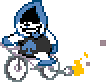
      </td>
      <td>
        <b>🎮 <a href="https://github.com/Yenni-Mid/Projetinho_gameplays">Projetinho_gameplays</a></b> <i>(Público)</i> 
        Laboratório prático de programação especializada em desenvolvimento de jogos e mecânicas interativas.
      </td>
    </tr>
    <tr>
      <td align="center" width="110">
        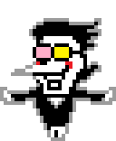
      </td>
      <td>
        <b>★ <a href="https://github.com/Yenni-Mid/Yenni-Mid">Yenni-Mid</a></b> <i>(Público)</i> 
        Repositório de perfil temático inspirado em <i>Deltarune</i>, com sprites, UI customizada e assets em pixel art.
      </td>
    </tr>
    <tr>
      <td align="center" width="110">
        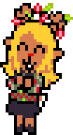
      </td>
      <td>
        <b>🌐 <a href="https://yenni-mid.github.io/">Portfólio Dark World (GitHub Pages)</a></b> <i>(Público)</i> 
        Site interativo com caixa de diálogo estilo <i>Deltarune</i>, barra de grupo e menu de batalha (<a href="https://github.com/Yenni-Mid/Yenni-Mid.github.io">código-fonte</a>).
      </td>
    </tr>
  </table>

 

  <b>★ ATIVIDADE NO DARK WORLD (SNAKE CONTRIBUTION GRAPH) ★</b>  
  <picture>
    <source media="(prefers-color-scheme: dark)" srcset="https://raw.githubusercontent.com/Yenni-Mid/Yenni-Mid/output/github-snake-dark.svg" />
    <source media="(prefers-color-scheme: light)" srcset="https://raw.githubusercontent.com/Yenni-Mid/Yenni-Mid/output/github-snake.svg" />
    
  </picture>

---

  

   
  
  &nbsp;
  
  &nbsp;
  
    
  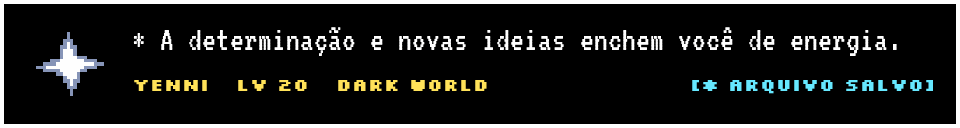
    
  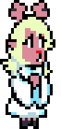

